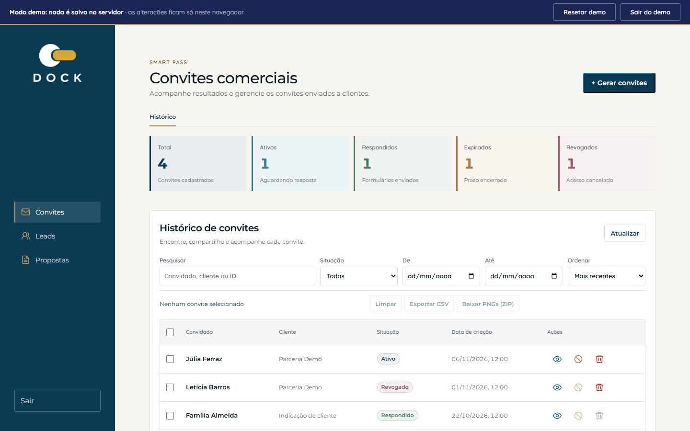
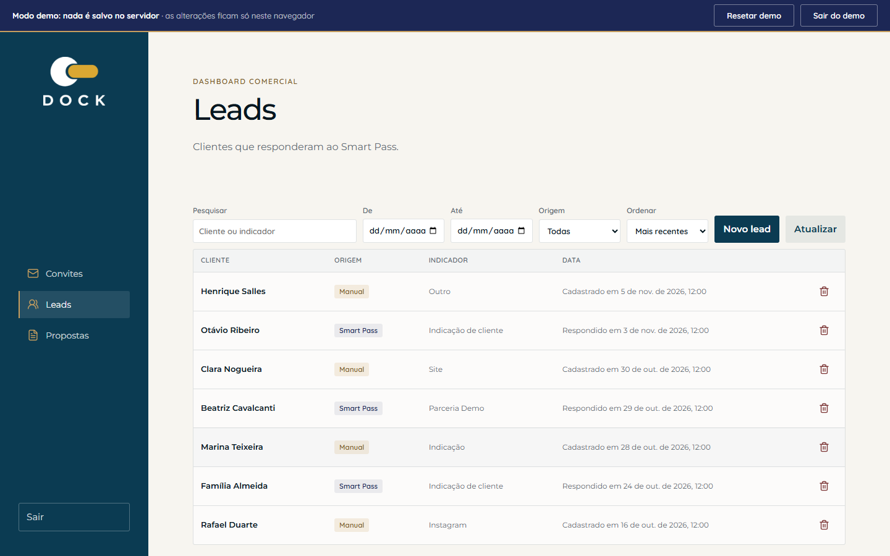
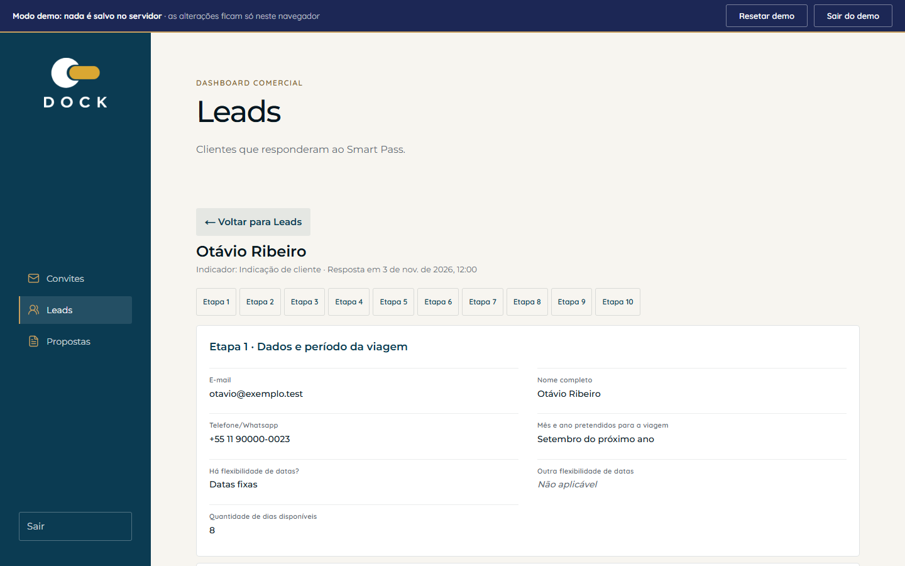
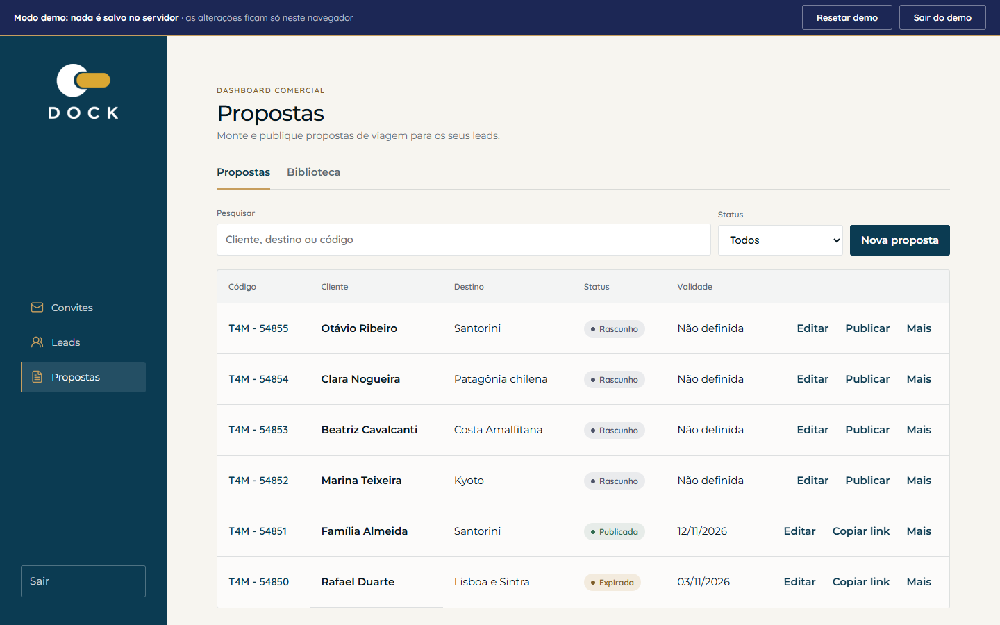
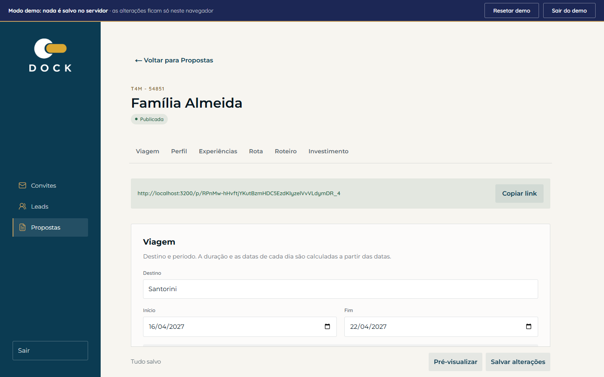
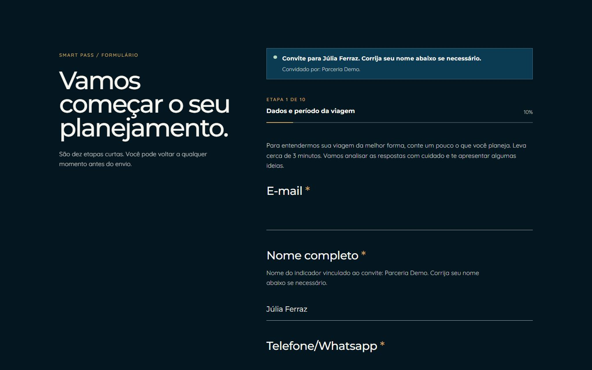
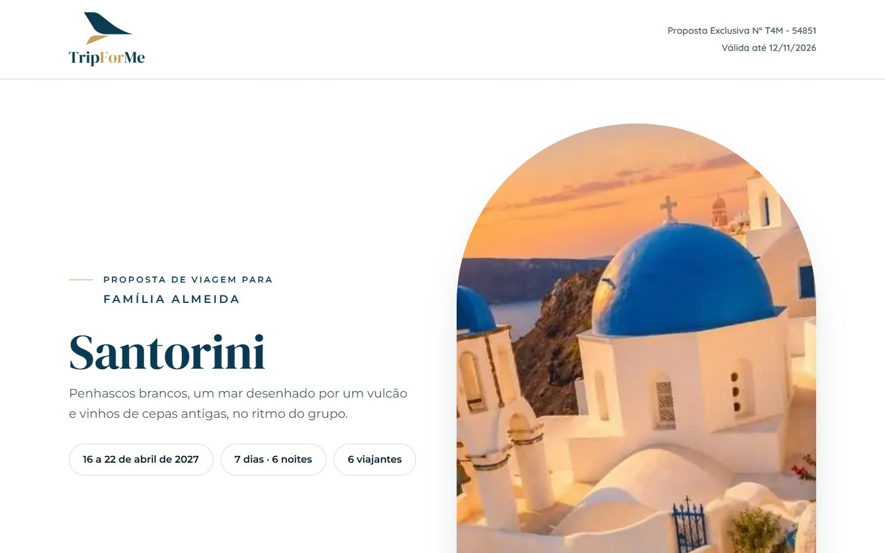
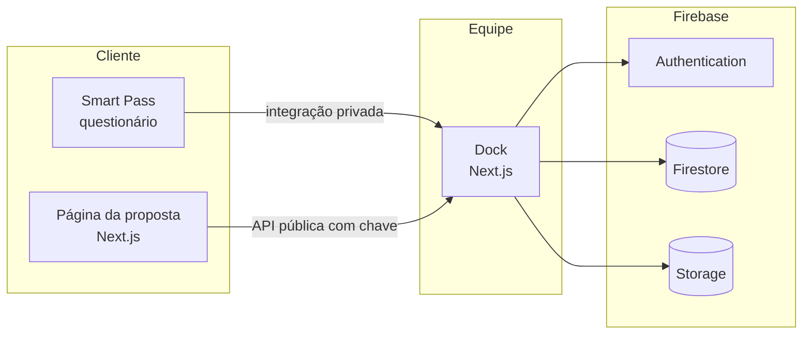

# Dock

**Painel comercial da Trip For Me: convites do Smart Pass, leads e propostas de viagem, com página pública para o cliente.**

> O código-fonte é privado porque tem regras de negócio e infraestrutura de produção. Este
> repositório mostra as telas, a arquitetura e as decisões técnicas. Todas as imagens saíram do
> **modo demo**, que usa apenas dados fictícios.

## Experimente

O demo abre sem login e com dados fictícios. Nada do que você fizer é enviado a um servidor: tudo
fica no seu navegador, e o botão "Resetar demo" volta ao estado inicial.

- **Demo do Dock:** [abrir o demo](https://dock-t4m-git-demo-douglas-projects-0db729d0.vercel.app/)
  (na tela de login, clique em **Explorar demo**)

Um roteiro para percorrer o produto inteiro:

1. Em **Convites**, gere um convite e abra o link dele.
2. Responda o questionário como se fosse o cliente.
3. Volte ao painel: o lead aparece em **Leads**, com as respostas.
4. Em **Propostas**, crie uma proposta, preencha e publique.
5. Copie o link e abra a página que o cliente veria.

## O problema

A equipe comercial da Trip For Me precisava de um lugar só para o caminho que vai do primeiro contato
até a proposta: convidar o cliente, receber as respostas, acompanhar o lead e entregar uma proposta
de viagem bem apresentada. O Dock reúne esse caminho em um painel e entrega ao cliente uma página
própria para cada proposta.

## O que o sistema faz

| Área | O que resolve |
|---|---|
| **Convites** | Gera convites individuais ou em lote para o Smart Pass, com histórico filtrável, resumo por situação, exportação em CSV, revogação e exclusão |
| **Smart Pass** | Questionário de 10 etapas que o cliente responde pelo link do convite; trata convite ativo, já respondido, expirado e inválido |
| **Leads** | Lista unificada de leads do Smart Pass e leads manuais, com filtros, detalhe das respostas por etapa e cadastro manual |
| **Propostas** | Editor por seções (viagem, perfil, experiências, rota, roteiro, investimento), envio de imagens, publicar e despublicar, duplicar, salvar como modelo e pré-visualizar |
| **Biblioteca** | Modelos de proposta reutilizáveis |
| **Página da proposta** | Página pública por link, com validade; mostra o estado de expirada ou não encontrada |

## Telas

| | |
|---|---|
|  |  |
| Leads do Smart Pass e manuais | Respostas do cliente, etapa por etapa |
|  |  |
| Propostas por situação: rascunho, publicada, expirada | Editor da proposta |
|  |  |
| Questionário do cliente | Página pública da proposta |

## Arquitetura (resumo)

Detalhes em [docs/arquitetura.md](docs/arquitetura.md).

## Destaques técnicos

- **Modo demo sem nenhuma chamada de rede de backend.** Um roteador local no navegador responde
  às rotas da API com os mesmos contratos das rotas reais, sobre um estado guardado em
  `localStorage`. O demo roda num projeto separado, sem credenciais do Firebase, e fica desligado por
  padrão no código de produção.
- **Os mesmos componentes em produção e no demo.** A página da proposta é importada do app real, sem
  cópia, e as regras de negócio puras (esquema, validação, CSV, resposta pública) são reaproveitadas.
- **Dados de demonstração que não envelhecem.** A semente usa datas relativas a "hoje": a proposta
  publicada continua válida e a expirada continua expirada, qualquer que seja o dia em que a pessoa abra.
- **Página pública que não revela nada a mais.** Qualquer falha de acesso à proposta responde o mesmo
  "não encontrada", a expiração é calculada a cada requisição e as imagens passam por um proxy que
  recusa propostas despublicadas.
- **Formato da proposta em um único lugar.** O esquema, os limites e a validação ficam em um arquivo
  compartilhado entre o painel e a página pública.
- **Testes.** Esquema, transformações, API pública, renderização da página, fluxo de ponta a ponta e
  um conjunto próprio do demo, incluindo um teste que falha se algo do demo tentar chamar a rede.

Mais em [docs/decisoes.md](docs/decisoes.md).

## Stack

- **Painel e página da proposta:** Next.js 16, React 19, TypeScript, Sass
- **Backend:** rotas de API do Next.js em Node, Firebase (Authentication, Firestore, Storage) pelo Admin SDK
- **Hospedagem:** painel em servidor Node, página da proposta e demo na Vercel
- **Qualidade:** testes em Node para esquema, API, renderização e fluxo completo, `eslint` e `tsc --noEmit`

## Contato

Douglas Viegas · [github.com/doug-viegas-dev](https://github.com/doug-viegas-dev)
· douglasviegas97@gmail.com · (53) 99942-4900
