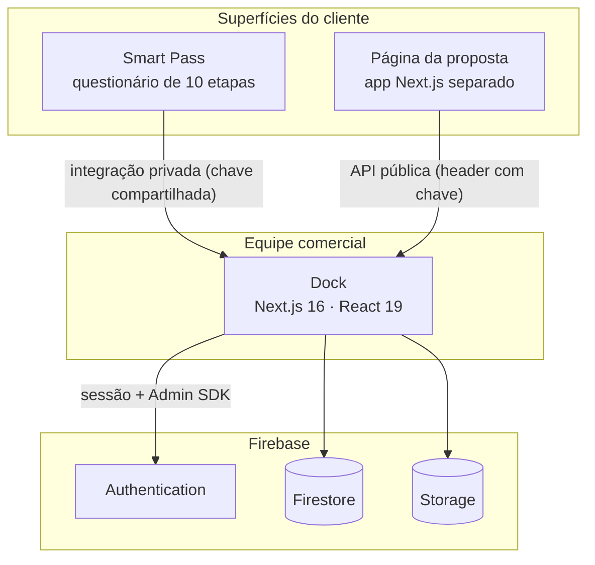
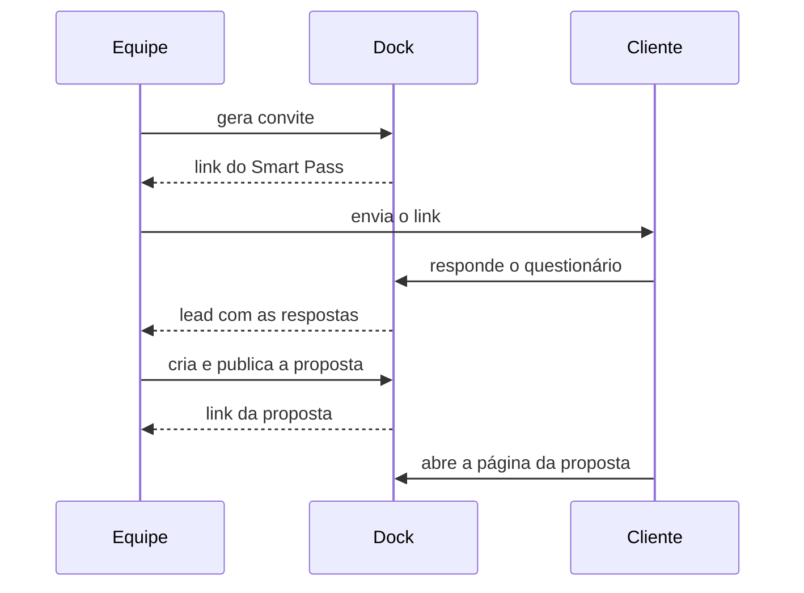
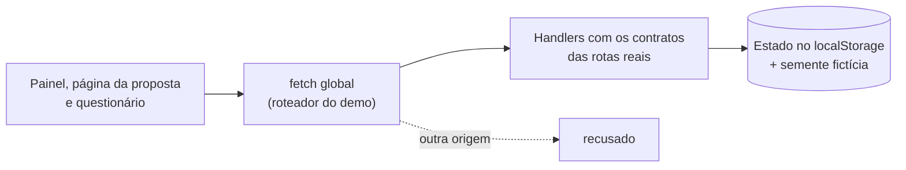

# Arquitetura

Visão geral de como as peças do Dock se encaixam. Nomes de projeto, IDs, chaves e endereços de
infraestrutura foram omitidos de propósito.

## Componentes

- **Dock**: painel autenticado com três áreas (Convites, Leads, Propostas). As rotas de gestão
  exigem a sessão do Dock e as mutações conferem a origem da requisição.
- **Smart Pass**: app separado onde o cliente responde o questionário. O envio chega ao Dock por
  um endpoint privado protegido por chave compartilhada, e o Dock o transforma em lead.
- **Página da proposta**: app Next.js separado que lê uma API pública do Dock. A API devolve só os
  campos que a página precisa. Qualquer falha de acesso responde o mesmo "não encontrada".
- **Imagens da proposta** passam por um proxy do Dock, que recusa propostas expiradas ou despublicadas.
- **Formato da proposta**: um arquivo de esquema compartilhado define campos, limites e validação, e
  é importado pelo Dock e pela página pública.

## Do convite à proposta

## Leads

O Dock mostra uma lista só, montada a partir de duas fontes: respostas do Smart Pass e leads
cadastrados à mão. Uma proposta pode ser criada a partir de qualquer um dos dois.

## Modo demo

- O demo só existe quando uma variável de ambiente o liga no build. Sem ela, as rotas públicas
  respondem 404 e o botão de entrada nem aparece.
- Ligado, um `fetch` global atende as rotas de API em memória, com handlers que espelham os contratos
  das rotas reais. Rotas sem handler respondem erro explícito, e URLs de outra origem são recusadas.
- Painel, página da proposta e questionário rodam na mesma origem, então compartilham o mesmo
  estado local, sem troca de dados entre domínios.
- O código do demo não entra nas páginas do build de produção: um teste confere que nada fora dele o importa.

Ver [decisoes.md](decisoes.md).
